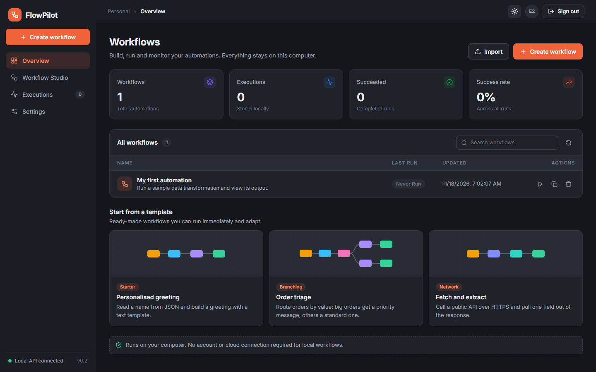
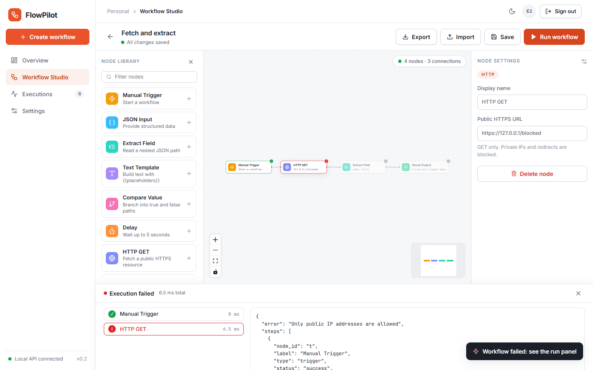
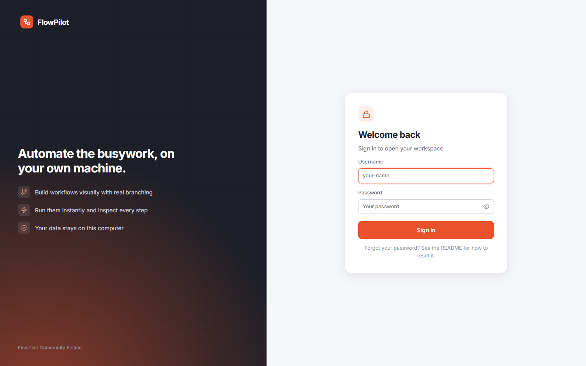
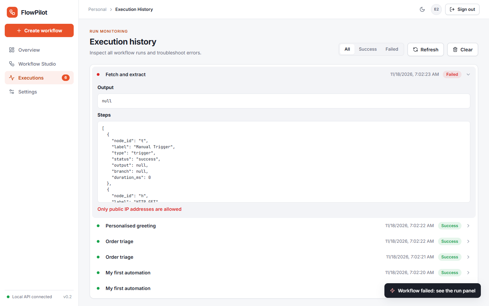
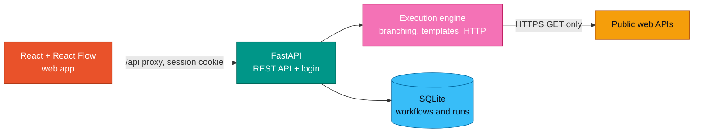

<div align="center">


<br/>


**Design workflows visually. Branch on conditions. Call APIs. Inspect every run.**
**No account, no cloud, no subscription.**

</div>

---

## 

<table>
  <tr>
    <td width="50%"><br/><sub><b>Overview</b> with stats, your workflows and starter templates (light theme)</sub></td>
    <td width="50%"><br/><sub><b>Dark theme</b>, remembered between visits</sub></td>
  </tr>
  <tr>
    <td width="50%"><br/><sub><b>Branching</b>: only the matching path runs, the other is greyed out</sub></td>
    <td width="50%"><br/><sub><b>Failure inspection</b> with the failing node marked on the canvas</sub></td>
  </tr>
  <tr>
    <td width="50%"><br/><sub><b>Sign in</b> screen protecting your workspace</sub></td>
    <td width="50%"><br/><sub><b>Execution history</b> with status filters and step details</sub></td>
  </tr>
</table>

---

## 

| Area | What you get |
| :--- | :--- |
| **Visual editor** | Drag, connect and configure nodes on a React Flow canvas with a minimap, zoom and a searchable node library |
| **Real branching** | The Compare Value node has green *true* and red *false* outputs. Only the matching branch executes |
| **Nine node types** | Manual Trigger, JSON Input, Extract Field, Text Template, Compare Value, Delay, HTTP GET, Pass Through, Result Output |
| **Seven comparison operators** | equals, does not equal, contains, greater than, less than, exists, does not exist |
| **Run feedback** | Per-node success, error and skipped badges on the canvas, plus per-step timings in milliseconds |
| **Templates** | Three ready-made workflows to start from: greeting, order triage (branching) and fetch-and-extract (HTTP) |
| **Workflow management** | Create, rename, duplicate, delete, import and export as JSON, run directly from the dashboard |
| **Execution history** | Every run stored with output and steps, filterable by status, with one-click clear |
| **Editor comfort** | Unsaved-change indicator, Ctrl+S to save, light and dark themes, branded browser tab title and icon |
| **Login** | Owner account created on first visit, salted PBKDF2 password hashing, 7-day sessions in an HttpOnly cookie, lockout after 5 failed attempts, every API route locked until you sign in |
| **Safe by default** | HTTPS-only public destinations, private and metadata addresses blocked, redirects refused, 8 second timeout, 1 MB response cap |

---

## 

### Windows

1. Install **Python 3.11 or newer** (tick *Add Python to PATH*) and **Node.js LTS**.
2. Extract or clone this project, for example to `C:\FlowPilot`.
3. Double-click **`start-windows.bat`**. The first launch installs dependencies and opens two terminal windows.
4. Open **http://127.0.0.1:5173** in your browser. On first visit you create your owner account (see below).

### macOS and Linux

```bash
./start-mac-linux.sh
```

### Manual start (any platform)

```powershell
# Terminal 1: API
cd backend
py -3 -m venv .venv
.\.venv\Scripts\python.exe -m pip install -r requirements.txt
.\.venv\Scripts\python.exe -m uvicorn app.main:app --host 127.0.0.1 --port 8000

# Terminal 2: web app
cd frontend
npm install
npm run dev
```

Interactive API documentation is served at **http://127.0.0.1:8000/docs**.

---

## 

- **First visit:** FlowPilot shows *Create your account*. Choose a username (3 to 40 characters) and a password of at least 8 characters. That single owner account is the only one; setup closes afterwards.
- **After that:** you sign in with that username and password. Sessions last 7 days or until you press **Sign out**.
- **Forgot the password?** Stop the API, then run this from the `backend` folder. It removes the owner account and sessions (workflows and history are kept) so the setup screen appears again:

```powershell
.\.venv\Scripts\python.exe reset_password.py
```

- **Upgrading from an earlier version:** existing workflows are kept. You will simply be asked to create the owner account on your next visit.

---

## 

1. On the **Overview** page choose the template **Order triage**.
2. Click **Run workflow**. The result is `PRIORITY: order A-1042 (250)` and the *false* branch is greyed out.
3. Select the **Compare Value** node and change *Compare to* from `100` to `1000`.
4. Run again. Now the *false* branch executes and you get `Standard: order A-1042 (250)`.

---

## 



A workflow is plain JSON (`nodes` and `edges`). The engine starts at the single Manual Trigger and walks the graph. A Compare Value node follows only the edge whose `sourceHandle` matches its result (`true` or `false`); every other node passes its output to all of its outgoing edges.

### Node reference

| Node | Settings | Output |
| :--- | :--- | :--- |
| Manual Trigger | none | nothing (starts the run) |
| JSON Input | JSON text | the parsed JSON |
| Extract Field | dotted path such as `user.items.0.name` | the value at that path, or `null` |
| Text Template | text with `{{path}}` placeholders | the rendered string |
| Compare Value | path, operator, comparison value | `{matched, value}`; routes to *true* or *false* |
| Delay | seconds, capped at 5 | the data it received, unchanged |
| HTTP GET | public HTTPS URL | parsed JSON, or text if the response is not JSON |
| Pass Through | none | the data it received, unchanged |
| Result Output | none | the final result shown in the run panel |

---

## 

**API, engine and login tests** (65 tests, use a temporary database):

```powershell
cd backend
.\.venv\Scripts\python.exe -m pip install -r requirements-dev.txt
.\.venv\Scripts\python.exe -m pytest
```

**Browser end-to-end tests** (23 checks driving a real Chrome or Edge, including account setup, sign in and sign out). These create and delete workflows, so start the API on a throwaway database first:

```powershell
$env:FLOWPILOT_DB = "$env:TEMP\flowpilot-e2e.db"
cd backend
.\.venv\Scripts\python.exe -m uvicorn app.main:app --host 127.0.0.1 --port 8000
# in another terminal, with the web app running:
cd frontend
npm run test:e2e
```

**Type check and production build:**

```powershell
cd frontend
npx tsc --noEmit
npm run build
```

---

## 

```text
flowpilot/
  start-windows.bat          one-click launcher for Windows
  start-mac-linux.sh         launcher for macOS and Linux
  backend/
    app/main.py              API, login and sessions, SQLite storage, execution engine
    reset_password.py        removes the owner account so you can set a new one
    tests/                   pytest suite
    requirements.txt
  frontend/
    src/App.tsx              auth gate, dashboard, editor, executions, settings
    src/Login.tsx            sign in and first-run account setup
    src/MiniFlow.tsx         workflow previews on template cards
    public/favicon.svg       browser tab icon
    src/nodes.tsx            custom canvas nodes and run-state badges
    src/catalog.ts           node definitions and starter templates
    src/styles.css           design tokens, light and dark themes
    e2e/e2e.mjs              browser end-to-end tests
  examples/hello-world.json  sample workflow to import
  docs/                      banner and screenshots
  ROADMAP.md
```

---

## 

- **Single user, local use.** There is one owner account and sessions run over plain HTTP on localhost. It is not hardened for the public internet: do not expose port 8000 or forward it on your router.
- **Manual triggers only.** Scheduling, webhooks, OAuth connectors, loops and queues are on the [roadmap](ROADMAP.md), not implemented.
- **One incoming connection per node.** Branches cannot merge back together yet, and cycles are rejected. One node may fan out to several.
- **HTTP node is GET only.** The URL checks are an MVP safeguard, not a hardened defence for untrusted multi-tenant use. Only run workflows you trust.
- **Run history can hold sensitive data.** Use sample data for now.
- **Backups:** stop the API, then copy `backend/flowpilot.db`.

---

## 

Scheduled and webhook triggers, credentials, more connectors, loops, merge nodes and a Postgres option are planned. See [ROADMAP.md](ROADMAP.md).

## Costs and licences

Running locally costs nothing. React, React Flow, FastAPI, SQLite and the other dependencies are free and open source. The web app optionally loads the Inter and JetBrains Mono fonts from Google Fonts and falls back to system fonts when offline. Any third-party API you call from an HTTP node may have its own terms and costs.
